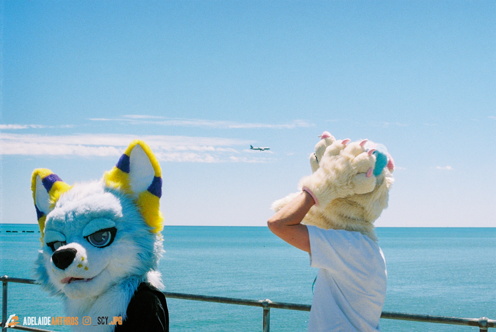
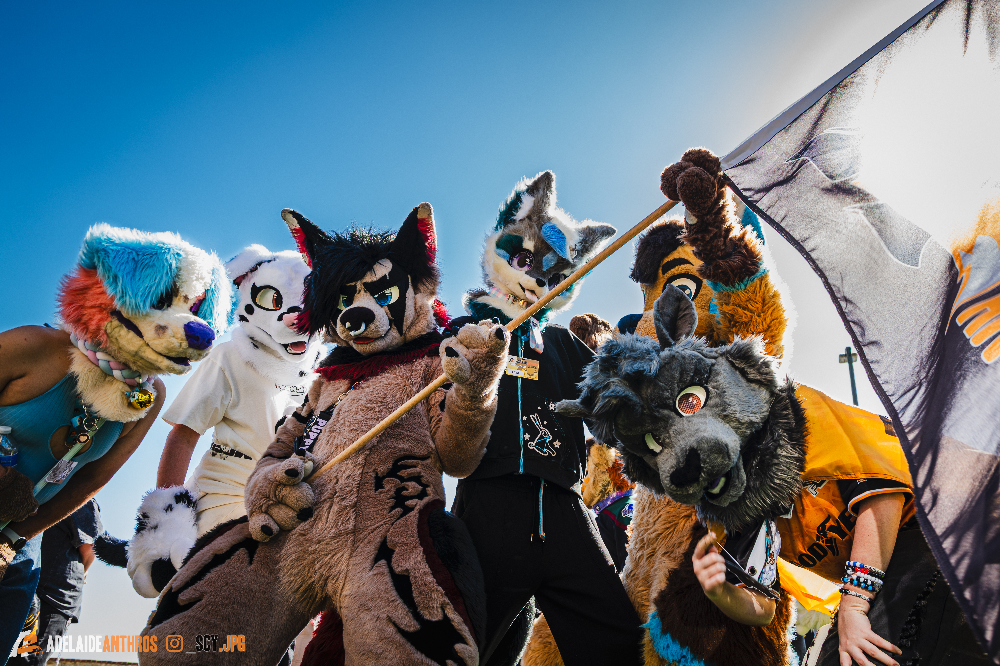
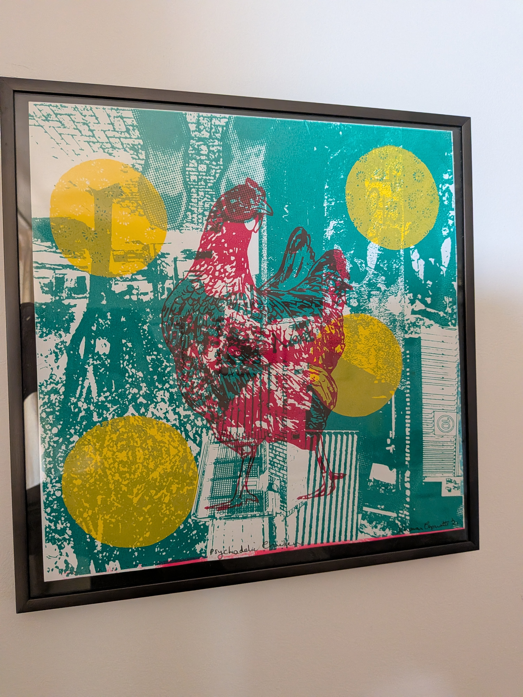

# Alone for the first time in a long time

In august i split from my partner of 3.5 years, and as of writing this, I've been 'single' for the longest period in my life since i was 21. Thats 12 years. Its strange. 

I'm trying to fill my time with things, and rebuild with the help of the people around me. I'm having trouble distinguishing what behaviours of mine are 'me' and what is being driven by my brain. 

## Make bad art

I'm feeling disconnected with my photography, which annoyingly coincides with joining an independent photojournalism association. I'm just unhappy with the pictures i'm making of the things around me. But weirdly i've enjoyed taking more selfies with Emma, i think i've lost some of the playfulness that drew me to it in the first place. 

I have this 'Make Bad Art' sticker on my fridge, and i think embracing that will help. even in the last day just taking dumb selfies has kind of been nice. 

## Grief

Jesus christ the grief is real, in the last 18 months i've lost 3 grandparents, two pets, my relationship, kind of another relationship. My grandma and namesake is also in hospital, potentially for end of life care. Literally whole life is being redirected. Like i'm doing okay, I think i will be okay. But my god it just feels like i keep getting punched in the face with *everything*. Over it. 

## Relationships

Extra confusing is my relationship with one of my closest friends, where there is a deep intimacy and shared way of living. I have moments of wanting them so much it aches. it feels silly, but i like the image of dancing in the kitchen while they sew, or being curled on a porch together with a morning coffee. I could see it being easy to build a life together. currently trying not to let that one spill out in a way that damages things. choosing to not pursue it feels like objectively the right decision given where my head is at, but fuuuuck did i want to be with them, and its hard not to feel like i've just... missed my chance. 

If it happens, it happens, but i can't live and build my life in a way that has that as an expectation. Timing sucks, hate this, really want to kiss 'em. 

# The good and things i'm looking forward to

Okay so enough self pity, or rather I feel like i end these on sad notes. Maybe we try for less sad. Something about your brain trending toward the things you give it. So i'm going to try and give it some cool shit. 

## Music

Listening to a lot of math and prog rock, some electronica, including:
- Delta Sleep
- Their Dogs Were Astronauts
- Romes
- Snayx

## Photos

### Weird Furry things

Worked a furry convention which was a FUCKING BLAST, i know i said I was in a funk with my photography, but i guess thats my more personal work. all the stuff i made for this has been really well recieved, including a lot of folks reaching out asking if i'd consider doing side stuff with them. Seems like fun! 

I also bought another camera (SL2-s), her name is Ethel. Yes she's a leica please don't @ me.

### Christmas Lights

I spent an evening wandering my neighbourhood, scouting for houses to take photos of when their christmas lights start sparkling. Did something like this last year which turned out a lot of fun, despite now going how i'd expected. I think there are some cool spots near me. 

## Movies

### You Can See Everything
Bizarre, loved it. Lots of questions about what is a 'documentary', and I think everyone should go see it. 

### Hunger Games: Sunrise on the Reaping
Definitely one of the movies of 2026. Idk i never got into the series, it just felt a bit bland. Visual effects were gorgeous though. 

## Plays

### Log Boy
Queer relationships, AIDS, history, hot gay men in leather. This play has it all. Cried *A LOT*. 

## Travel

I'm going to melbourne for new years to visit a friend I made at pycon this year. She's pretty cool, its rare meeting someone more inked than I am. That'll come after visiting family for xmas. I think it'll be really fucking nice to get out of adelaide for a bit and just exist somewhere else as myself with no expectations or preconceptions. 

## NAME CHANGE

Holy shit i put the paperwork in for my name changes, and thats fucking HUGE. Also we're on she/they pronouns. I'm straying perilously close to womanhood.......

## Books

I've had trouble reading the last few years, something something cptsd. But i'm slowly working my way through *To Photograph is to Learn How to Die* by Tim Carpenter. Its a delight, rambling, esoteric, feels very much like my own train of thought. 

## Art

Got some cool pieces from Floating Goose's *Keeping the Lights On*. Including a psychedelic chicken.

# Finishing up

So i wrote this in like 45 minutes at work just to get the shit thats on fire in my brain out of it. I do in fact feel much better now. 

I fucking love my friends by the way, they're so good. A lot of late nights on discord, phone calls, hangs. Just good people. 